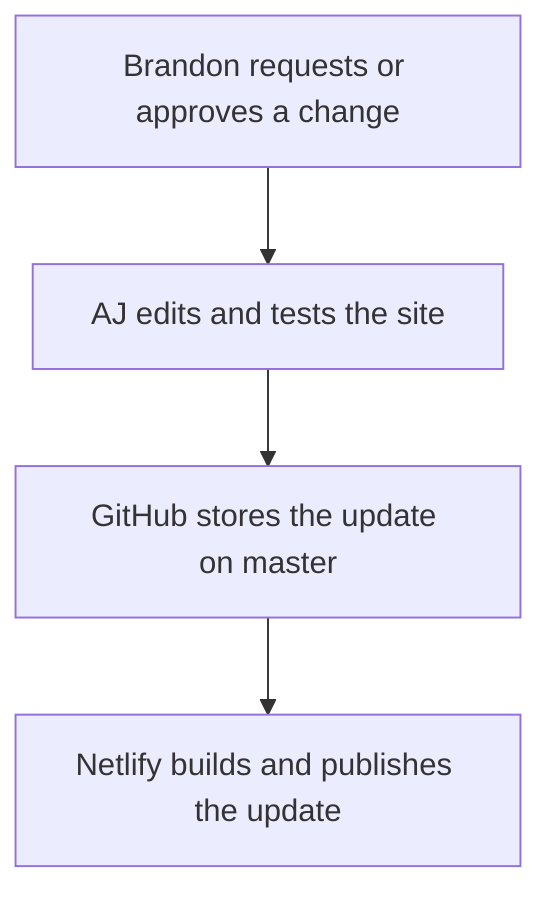
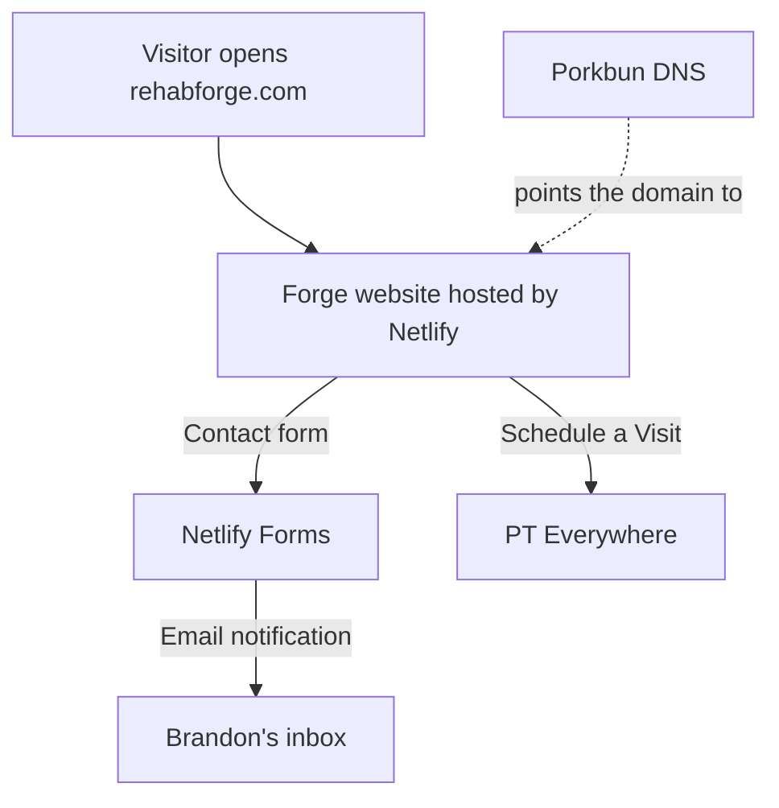

# How the Forge website works

> This map shows the planned setup **after the handoff to Brandon**. For the actual setup steps, use the [go-live walkthrough](go-live.md).

**GitHub keeps the website files. Netlify builds and hosts the site. Porkbun manages the address people type in.** The contact form and appointment scheduler do different jobs.

## 1. How a website update goes live

When AJ pushes an update to `master` (the branch used for the live site), Netlify automatically uses Astro to turn the source files into web pages and publish them. This is called a **deploy**. Brandon doesn’t need to press Publish, and AJ doesn’t need a Netlify team seat to push updates to the public GitHub repo. Brandon can see whether an update went live under **Deploys** in his Netlify dashboard.

## 2. How visitors reach the site, get in touch, and book

- **Website address:** Porkbun controls DNS, the records that tell browsers where to find `rehabforge.com`. Netlify serves the web pages and handles HTTPS. Website DNS changes should not touch the separate email records at Porkbun.
- **General inquiries:** Netlify Forms stores submissions in its dashboard and notifies `brandon@rehabforge.com` once notifications are set up. The form is not for sensitive medical information.
- **Appointments:** **Schedule a Visit** opens PT Everywhere. Clients create an account and book there. Appointments and availability are managed in PT Everywhere, not in GitHub, Netlify, or the contact form.

## 3. Who handles what after handoff?

| Where | What it's for | Who handles it |
| --- | --- | --- |
| [Forge GitHub organization](https://github.com/Forge-Rehab-Performance/website) | Website files and history | Brandon and AJ are organization owners. AJ makes, tests, and publishes code changes through GitHub. |
| Netlify | Hosting, deploy status, contact submissions, and email notifications | Brandon owns the project, watches Free plan usage, and receives inquiries. AJ helps diagnose site or build issues. |
| Porkbun | Domain renewal and records for the website and email | Brandon keeps the domain registration and renewal current. Coordinate with AJ before changing DNS. |
| PT Everywhere | Scheduling, availability, and appointments | Brandon manages the practice’s scheduling settings. AJ updates the website button if the booking link changes. |

## 4. Where to look first if something goes wrong

| What you notice | First check |
| --- | --- |
| A website change isn’t showing | In **Netlify → Deploys**, check whether the latest `master` update published successfully. If it failed, send AJ the deploy link. |
| `rehabforge.com` won’t load | Try the project’s `.netlify.app` address in **Netlify → Domain management**. If that works, check the custom domain’s DNS and HTTPS settings before changing anything. |
| Contact messages aren’t arriving | Check **Netlify → Forms → contact** for the submission or a spam flag. If it’s there, check the notification settings and Brandon’s inbox. |
| Clients can’t schedule | Try **Schedule a Visit**. If it opens the correct PT Everywhere page but there are no slots, check availability there. If the link is broken, tell AJ. |

After a site or account change, open the live site, check the booking link without making an appointment, and send a dummy contact message to confirm delivery. For a domain change or rollback, follow the [go-live walkthrough](go-live.md).
